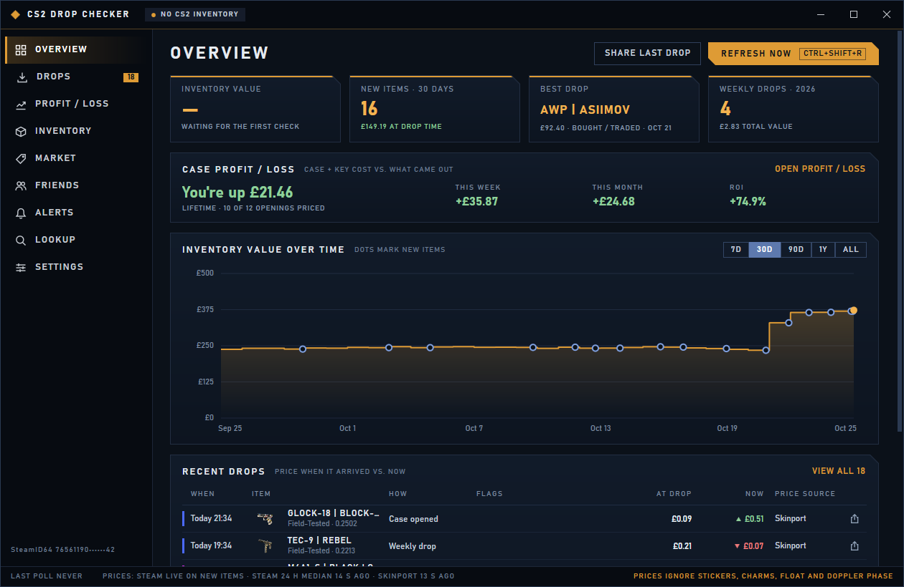
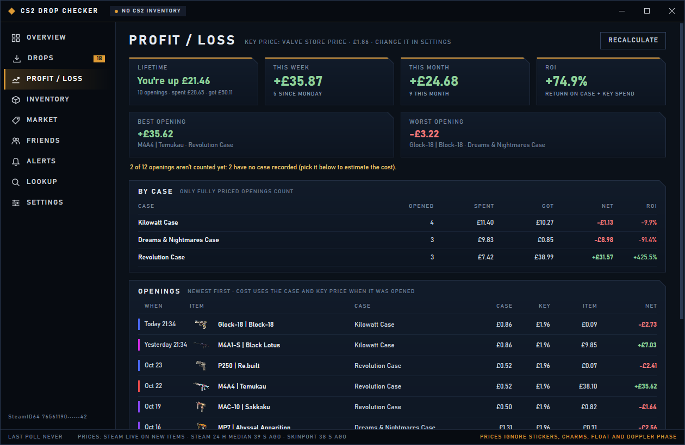
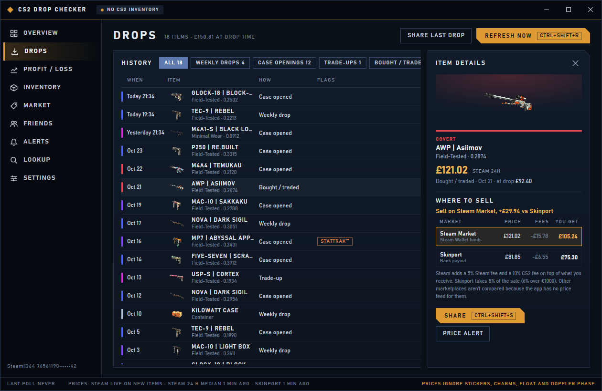
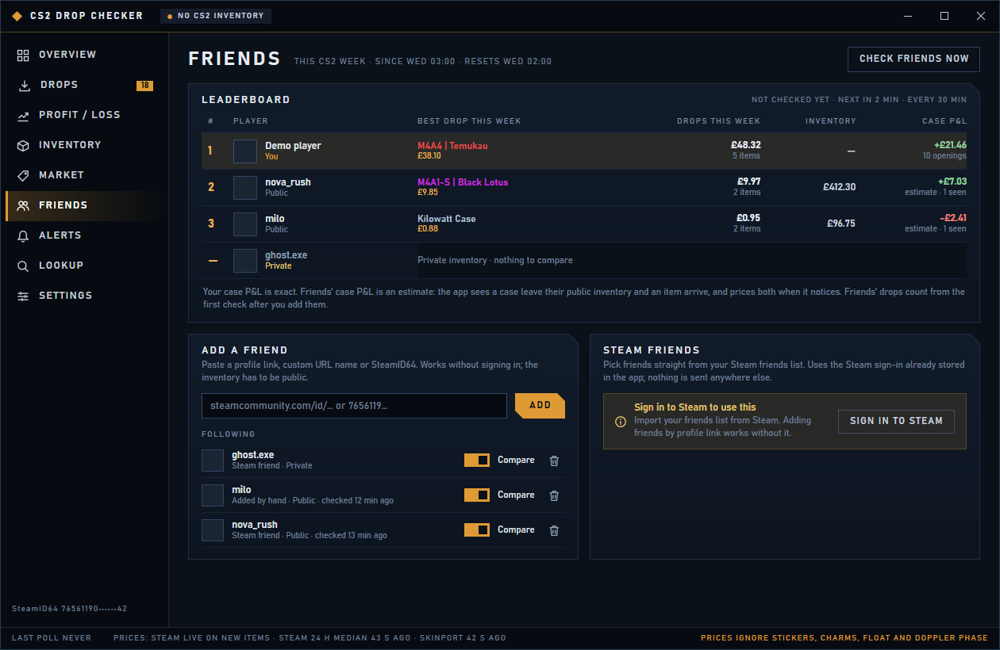
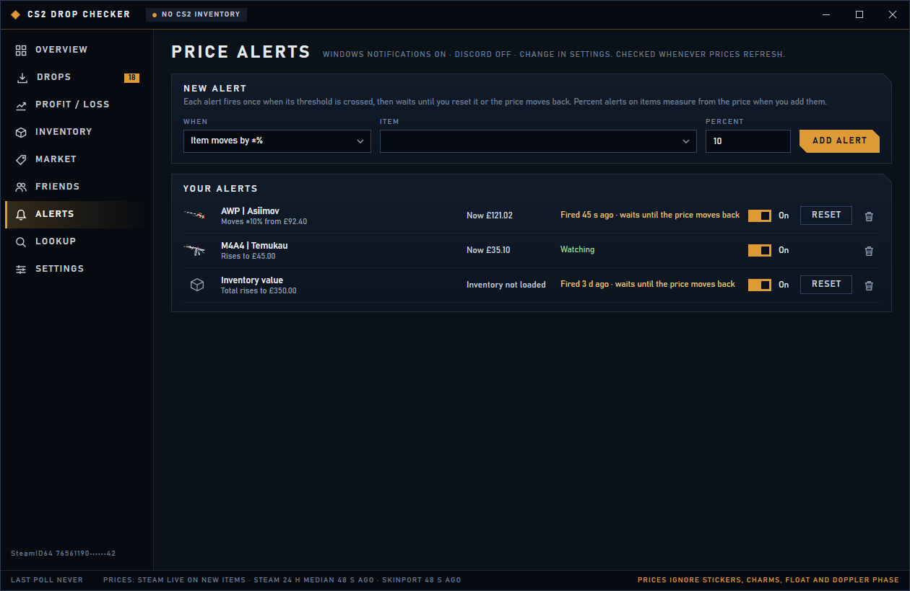
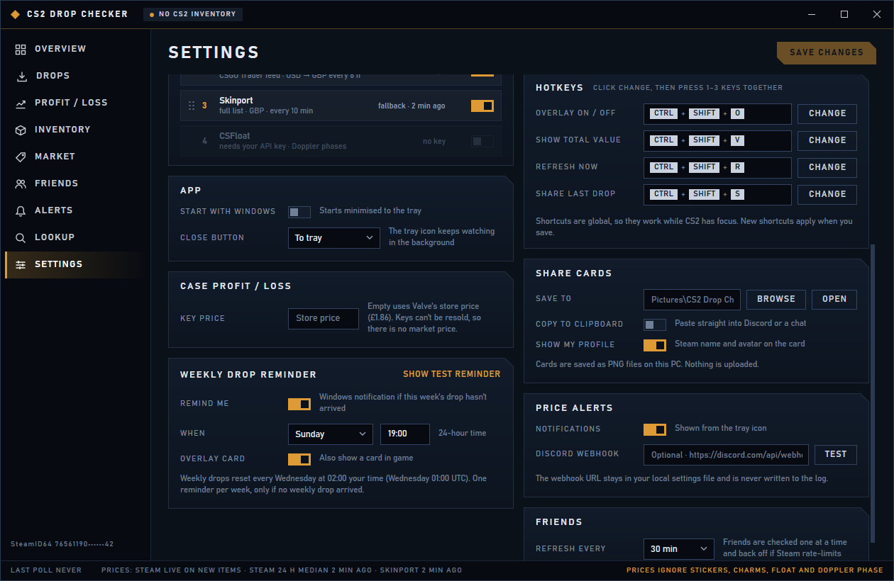

# CS2 Drop Checker

A small Windows app that watches your CS2 inventory and shows each new item (weekly drop, case opening, trade-up, market purchase) with its current Steam price in a card on top of the game. It also keeps a history of everything that arrived, tracks your inventory value over time and, if you sign in, lets you sell items on the Steam Community Market.

It works with Steam's web pages and the Community Market. It does not touch the game process, memory or files, and it only lists or removes market items when you click to do so.

## Download

Get `cs2-drop-checker.exe` (or the zip) from the [latest release](https://github.com/kaarude/cs2-drop-checker/releases/latest) and run it. Nothing to install: the exe is self-contained (Windows 10/11, x64).

The optional Steam sign-in uses the Microsoft Edge WebView2 Runtime, which ships with Windows 11 and current Windows 10.

## First run

The setup wizard asks for three things:

1. **Your Steam profile.** Paste a profile link (`steamcommunity.com/id/...` or `/profiles/...`), a custom URL name or a SteamID64. The wizard checks that the inventory can be read.
2. **Sign in (optional).** Signing in to Steam inside the app includes trade-protected items, so purchases show up right away instead of after the 7-day trade protection. It is also needed for selling. You sign in on Steam's own login page. The session stays in the app's private browser profile, and the app never sees or stores your password.
3. **Hotkeys and overlay.** Review the hotkeys and where the cards appear.

The inventory must be public if you don't sign in: Steam > Profile > Edit Profile > Privacy Settings > Inventory: Public.

## How it works

- While CS2 is running (or always, if you change that in Settings) the app checks the inventory every 3 minutes (2 to 60).
- Each check is compared with the previous one. Items that left the inventory explain the new ones: a consumed case means a case opening, five or more consumed skins mean a trade-up, a capsule means a capsule opening. Items moved in or out of storage units are not shown as new.
- Every new item gets a card in the overlay and a row in the Drops history, with the price at the time it arrived.

## Overlay

- Click-through and always on top. It never takes focus from the game.
- Run CS2 in **Fullscreen Windowed** (borderless). In exclusive fullscreen Windows can't draw the overlay; items are still detected and saved.
- Position, monitor, size, opacity and seconds per card are in Settings.

Default hotkeys (change them in Settings):

| Hotkey | Action |
| --- | --- |
| Ctrl+Shift+O | Turn the overlay on or off |
| Ctrl+Shift+V | Show the total inventory value |
| Ctrl+Shift+R | Check the inventory now |
| Ctrl+Shift+S | Share a card of the last drop |

## Prices

Sources are tried in the order set in Settings:

| Source | Data |
| --- | --- |
| Steam | Live Steam Community Market price for the item |
| Steam 24h | Daily Steam price feed from [CSGO Trader](https://csgotrader.app/) |
| Skinport | Skinport's public item prices |

Prices are shown in your chosen currency. Feeds in USD are converted with daily ECB rates from [Frankfurter](https://frankfurter.dev/). Items with stickers, charms or Doppler phases can be worth more than the listed price; the card says so.

## Selling on the Steam Market

Selling is on the Inventory page and needs the in-app Steam sign-in for the account you watch.

- The filter at the top right shows **Sellable** items, **Fresh** items still in the 7-day trade protection (with a countdown), and **Listed** items.
- Click a sellable item to open the sell window: the cheapest listing, highest buy order and 24-hour median, a 30-day sale price chart, and three quick prices (1 cent under the cheapest listing, the highest buy order, the median) or a custom price. You can type either what the buyer pays or what you get; the fees are shown before you list.
- Tick several items to sell them in one go with one price rule. Listings are sent one at a time.
- Steam asks you to confirm every listing in the Steam Mobile app or by email. The item isn't for sale until you do.
- When an item leaves trade protection, the overlay shows a **Now sellable** card with its price.

Steam keeps a fee from each sale (5% Steam, 10% CS2). The price the app shows as "you get" is after both fees.

## Pages

- **Overview:** inventory value over time, case profit/loss, best drop, weekly drop count and recent drops (price when it arrived vs. now).
- **Drops:** the full history, filtered by drops, openings, trade-ups or purchases. Click a row for selling options.
- **Profit / Loss:** what your case openings cost and returned.
- **Inventory:** the current inventory with prices and where each item sells for most. With sign-in, also the sell filter and selling.
- **Market:** your Steam Wallet, your listings (cancel any of them) and your sales, with the profit compared to each item's price when it arrived.
- **Friends:** a weekly leaderboard with friends.
- **Alerts:** price alerts for items and for your inventory total.
- **Lookup:** a one-time look at any public profile's inventory and value. Nothing is saved.
- **Settings:** account, price source order, overlay, hotkeys, start with Windows and the settings for the features below.



## Features

### Case profit / loss

Every case or capsule opening is stored with its cost at that moment (case price plus key price) and the price of the item that came out. The Profit / Loss page shows the lifetime result ("You're down £47.20"), this week and this month, ROI, the best and worst opening and a table per case type. The Overview has a short version.

- Keys bought since 2019 can't be resold, so there is no market price. The app uses Valve's store price ($2.49, converted to your currency) unless you set your own key price in Settings > Case profit / loss.
- Openings that were already in your Drops history are imported once. The app couldn't tell then which case was used, so they show "Case unknown": pick the case on the Profit / Loss page and it is costed at today's case and key price (marked "est.").
- Only fully priced openings in your current currency count towards the totals; the page says how many are missing.



### Best place to sell

See what you'd actually get on each market after fees, with the best one highlighted ("Sell on Skinport, +£3.20 vs Steam"). It is in the sell window when you click a sellable Inventory item, and in the item details panel when you click a row on the Drops page, an item you can't list from the app (not signed in, not marketable) or an item on the Lookup page. All fees are in one place, `SellFees` in `src/Cs2DropChecker.Core/Selling/Selling.cs`. The sell window uses the same Steam fee calculation, with your wallet's own fee rates when Steam sends them:

| Market | Fee | Paid out as |
| --- | --- | --- |
| Steam Community Market | 5% Steam fee + 10% CS2 fee, both on top of what you receive (each at least $0.01) | Steam Wallet funds |
| Skinport | 8% of the sale, 6% for sales over €1,000 | Bank payout |

Sources: [Steam Community Market FAQ](https://help.steampowered.com/en/faqs/view/61F0-72B7-9A18-C70B) and Skinport's seller fee page. Other marketplaces aren't compared because the app has no price feed for them.



### Share cards

The Share button (on each drop row, in the item details, "Share last drop" on Overview and Drops, or Ctrl+Shift+S, also while in game) makes a PNG card with the item image, name, wear, price and rarity colour, your Steam name and avatar (can be turned off) and a small watermark. It is copied to the clipboard and saved to `Pictures\CS2 Drop Checker` (change both in Settings > Share cards). Nothing is uploaded.

### Friends leaderboard

Compare with friends: best drop this CS2 week, total drop value this week, inventory value and case profit/loss. Weekly drops, case openings and trade-ups count as drops; bought or traded items don't.

- **Add by hand:** paste any public profile link, custom URL name or SteamID64. Works without signing in.
- **From your Steam friends list:** needs the Steam sign-in. Tick the friends to compare with.
- Friends' inventories are read from public Steam data, one friend at a time, every 30 minutes by default (Settings > Friends), with a pause between friends and a back-off when Steam rate-limits.
- Private inventories show as "Private". A friend's drops count from the first check after you add them.
- Your own case P&L is exact. A friend's is an estimate: the app sees a case leave their inventory and an item arrive, and prices both when it notices.



### Price alerts

Alerts for an item (moves by ±X%, rises to or falls to a price) or for the inventory total (rises to or falls to a value, moves ±X% in 24 hours). They are checked whenever prices refresh. Each alert fires once, then waits until the value moves back past the threshold or you press Reset. Alerts arrive as a Windows notification and, optionally, as a message to a Discord webhook. The webhook URL is kept only in your local settings file and is never written to the log.



### Weekly drop reminder

CS2 weekly drops reset every Wednesday at 01:00 UTC. If this week's weekly drop hasn't arrived by the day and time you choose (default Sunday 19:00), the app shows one Windows notification and, optionally, an overlay card. Turn it off in Settings > Weekly drop reminder.

### What needs the Steam sign-in

| Feature | Without sign-in | With sign-in |
| --- | --- | --- |
| Drops, inventory, prices, overlay | Yes (public inventory) | Also trade-protected items right away |
| Case profit / loss, share cards, price alerts, weekly reminder, best place to sell | Yes | Yes |
| Friends added by profile link | Yes | Yes |
| Import friends from your Steam friends list | No | Yes |

Features that need the sign-in show "Sign in to Steam to use this" with a button to the sign-in step.

### New settings

| Section | Setting | Default |
| --- | --- | --- |
| Case profit / loss | Key price | Empty: Valve store price, converted |
| Share cards | Save to / Copy to clipboard / Show my profile | `Pictures\CS2 Drop Checker` / on / on |
| Price alerts | Notifications / Discord webhook | On / empty |
| Friends | Refresh every | 30 min |
| Weekly drop reminder | Remind me / When / Overlay card | On / Sunday 19:00 / on |
| Hotkeys | Share last drop | Ctrl+Shift+S |



## Updates

The app checks GitHub for a newer release every few hours. When one is out, a yellow **Update** button appears at the bottom of the sidebar. Click it to download the new exe, swap it in place and restart. If the app's folder isn't writable, move the exe somewhere it is, or download the new version from the releases page.

## Data

Settings are in `%APPDATA%\CS2DropChecker`. The database, image cache, logs and the sign-in browser profile are in `%LOCALAPPDATA%\CS2DropChecker`. Delete both folders to reset the app.

The database upgrades itself when a new version starts. The upgrade only adds new tables, so existing history is kept.

## Build from source

Requires the .NET 10 SDK on Windows.

```powershell
dotnet build Cs2DropChecker.slnx
dotnet test Cs2DropChecker.slnx
.\publish.ps1   # writes cs2-drop-checker.exe and cs2-drop-checker.zip to the repo root
```

Projects:

- `src/Cs2DropChecker.Core`: Steam profile and inventory reading, snapshot diff and drop classification, price sources, market fees and parsers, case profit/loss, selling comparison, alerts, friends, update checker, SQLite storage.
- `src/Cs2DropChecker.App`: WPF app (main window, setup wizard, sell windows, overlay, tray, hotkeys, share cards, notifications, self-update).
- `tests/Cs2DropChecker.Core.Tests`: unit tests for the core library.

Set `CS2DC_HOME` to a folder to keep all app data there instead (useful for testing).

## License

MIT. Not affiliated with Valve. CS2 and Steam are trademarks of Valve Corporation.
